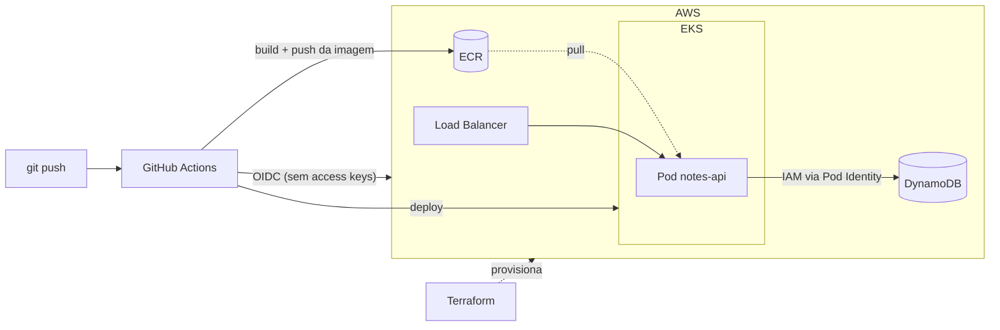

# spring-aws-k8s-lab


Lab de estudo: uma API de notas em **Spring Boot** levada do notebook até a **AWS**, passando por **Docker**, **Kubernetes**, **Terraform** e **CI/CD no GitHub Actions**.

O projeto é construído em fases pequenas. Cada uma tem anotações em [`docs/`](docs/) com os conceitos, os comandos usados e o porquê de cada decisão.

## Arquitetura alvo



Toda a infraestrutura é declarada em Terraform, incluindo um alarme de budget para evitar surpresas na conta.

## Roteiro

| Fase | Conteúdo | Custo AWS | Status |
|------|----------|-----------|--------|
| 1 | API Spring Boot, testes de integração, Docker, compose com DynamoDB Local | zero | ✅ [anotações](docs/fase-1.md) |
| 2 | Kubernetes local com `kind`: Deployment, Service, ConfigMap, probes | zero | 🚧 em andamento |
| 3 | Terraform na AWS: budget, ECR, DynamoDB, IAM, OIDC do GitHub | ~zero | ⏳ |
| 4 | EKS via Terraform e pipeline de deploy | por hora; `destroy` ao final | ⏳ |
| 5 | Extras: HPA, Prometheus/Grafana, ambiente de staging | por hora | ⏳ |

## Estrutura

```
.
├── app/            # API Spring Boot (Maven wrapper, Dockerfile, testes)
├── k8s/            # manifests Kubernetes (fase 2)
├── docs/           # anotações de estudo por fase
└── compose.yaml    # ambiente local: API + DynamoDB Local
```

## Rodando localmente

Requisitos: Docker. Para rodar os testes ou a API fora do container, também Java 25. Maven não é necessário, porque o projeto usa o wrapper `./mvnw`.

```bash
docker compose up --build

# em outro terminal
curl -X POST localhost:8080/notes -H 'Content-Type: application/json' \
  -d '{"title":"primeira nota","content":"oi"}'
curl localhost:8080/notes
```

Testes de integração (sobem o DynamoDB Local via Testcontainers, então precisam do Docker rodando):

```bash
cd app && ./mvnw test
```

### No Kubernetes local (fase 2, em andamento)

```bash
kind create cluster --name lab
docker build -t notes-api:0.1.0 ./app
kind load docker-image notes-api:0.1.0 --name lab
kubectl create namespace lab
kubectl apply -f k8s/
```

## API

| Método | Rota | Descrição |
|--------|------|-----------|
| `POST` | `/notes` | cria nota (`title` obrigatório, até 200 caracteres) |
| `GET` | `/notes` | lista notas |
| `GET` | `/notes/{id}` | busca nota; `404` se não existir |
| `DELETE` | `/notes/{id}` | remove nota |
| `GET` | `/actuator/health/liveness` | liveness probe |
| `GET` | `/actuator/health/readiness` | readiness probe |
| `GET` | `/actuator/prometheus` | métricas no formato Prometheus |

## Decisões de projeto

- **DynamoDB em vez de RDS:** sem instância parada cobrando e sem exigir subnet privada; acesso controlado só por IAM.
- **Nenhuma credencial no código ou na imagem:** local usa DynamoDB Local; na AWS o SDK pega credenciais temporárias pela cadeia padrão (Pod Identity no EKS).
- **Configuração por variável de ambiente:** a mesma imagem roda no compose, no `kind` e no EKS.
- **Imagem multi-stage, usuário não-root** e heap da JVM dimensionado pelo limite de memória do container.
- **Testes contra DynamoDB real (local)** com Testcontainers, em vez de mocks.

## Stack

Java 25 · Spring Boot 4 · AWS SDK v2 (DynamoDB Enhanced Client) · JUnit 5 · Testcontainers · Docker · Kubernetes (`kind`)
